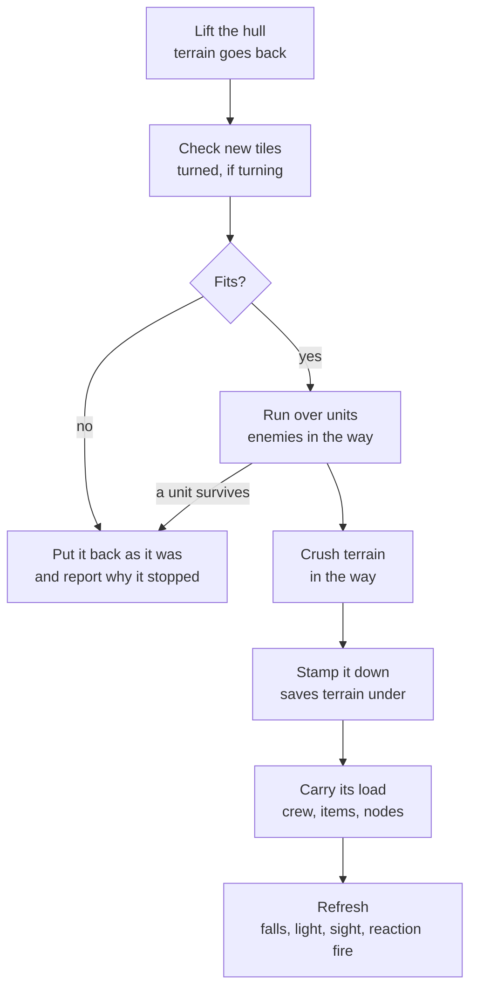
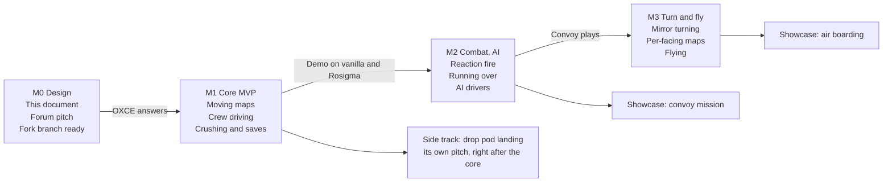

# Moving Vehicles for OXCE — Design

Last updated 2026-10-29 · Aleix Ruiz Sorribes

Why each game design choice was made, and what we turned down, is logged in [GAME_DESIGN_DECISIONS.md](GAME_DESIGN_DECISIONS.md).

## Summary

Moving vehicles lets a mod mark parts of a battle map, such as a craft, a UFO or a convoy, as vehicles that drive during the battle, carrying the units and items on board. A vehicle stays ordinary terrain, built from the map art mods already have, so soldiers walk inside it, shoot out of it, take cover in it and blow holes in it.

**Goals**

- Works with existing map art: no new sprites needed to make a craft map move.
- Opt-in per craft or UFO; vanilla UFO and TFTD play exactly as today.
- Units on board stay normal units: they walk, shoot, get out, and are carried along.
- The player and the AI can both drive.
- Saves, fog of war, lighting, reaction fire and explosions all keep working.

**Non-goals**

- Big multi-tile units (a 5x5 titan as one unit): a different feature, parked.
- Free rotation art: a vehicle can only show the facings its art exists for (see Turning).
- Vehicles on the Geoscape, or changes to how crafts work outside battle.
- Replacing today's 2x2 tank units (HWPs), which keep working as they are.

## Where we are

The Rosigma prototype proved the concept works on real mod art, but it was built for a showcase and is redone, not ported. It lives on the `prototype/moving-vehicles` branch as a reference.

| Feature | Prototype result | Plan |
| --- | --- | --- |
| Moving craft and UFO maps with units, items and route nodes | Works (Chimera, Baneblade, Monolith) | Keep the idea, rebuild the data model |
| Driving with a route preview and a ghost | Works, but through a spawned skull unit | Redesign who drives (see Driving) |
| Crushing terrain | Works | Keep, with clearer rules |
| Running over units | Works | Keep, make damage configurable |
| AI-driven vehicles | Works, but cheats | Redo (see AI vehicles) |
| Choosing where drop pods land | Works | Side track (see Drop pods) |
| Flying (Valkyrie) | Works | Follow-up |
| Turning | South and east only, plus a facing arrow | Redesign (see Turning) |

**Debt we leave behind**

- Debug keys (Ctrl+Y and friends) and test-only code paths.
- Untranslated English messages ("rammed a unit", "Landed").
- A fake driver unit placed on the roof, which is shot, counted and saved like a soldier.
- Two settings blocks with different key names for crafts (`driverUnit`, `tuPerTile`) and UFOs (`driverUnits`, `moveTiles`).
- Each route check allocates a table as big as the map and scans every unit on it.
- AI vehicles drive toward player units they can't see, for free, once per turn.
- The landing phase works by intercepting map clicks.
- The facing arrow, a showcase-only hack.
- No reaction fire against moving vehicles.
- No tests or validation beyond playing the Rosigma test missions.

## Upstream strategy

We offer OXCE a small core first and keep everything else as separate follow-ups, so each piece can be accepted or declined on its own. Only OXCE collaborators can open pull requests, so the work lives on our fork (`AleixRuiz/OpenXcom`, branch `moving-vehicles`) and is pitched on the openxcom.org forum.

| Tier | Contents | Where it lives |
| --- | --- | --- |
| Core | Craft maps that move with what's on board, driving by a crew member, route preview, terrain that blocks or is crushed, saves (see [MVP](MVP.md)) | Pitched to OXCE first |
| Follow-ups | Running over units, reaction fire rules, UFO vehicles with AI driving, turning, flying, choosing where drop pods land | Pitched one by one after the core |
| Mod side | Rosigma vehicles, showcase missions, any art-specific tricks | Rosigma rulesets, never in the engine |

If OXCE declines or reshapes the core, the fork keeps working and Rosigma can ship it as a custom build. That choice belongs to the Rosigma team.

## Core model

A vehicle is a set of tile parts (floors, walls, objects) that the engine lifts off the map and stamps down somewhere else, one tile per step, remembering the terrain it covers. Nothing about it is a unit: the hull is terrain, and the crew are ordinary units standing on it.

**What moves with the vehicle**

- Its own tile parts, in their current state: a wall shot off stays missing.
- Units standing on its floors, plus mounted guns (units that can't walk) on any of its tiles. The vehicle holds its mounted guns: they never fall out, even where it hangs over lower ground ([GD-19](GAME_DESIGN_DECISIONS.md#gd-19--mounted-guns-are-held-by-their-vehicle)).
- Items lying on its floors, including bodies.
- Its route nodes, so AI units keep walking it correctly.
- What players have discovered of it in the fog of war.

**What stays behind**

- The terrain under it, put back as it was when the vehicle leaves.
- Terrain it crushed on the way, which stays destroyed.
- Fire and smoke, which belong to map tiles.

**Which parts belong to a vehicle.** The engine loads a craft or UFO map with its own copy of each tileset, so its parts are recognizable by tileset. Vehicles placed inside ordinary map blocks (a parked truck in a city) share tilesets with the terrain and need per-part ownership; that is a later step.

**What changes from the prototype.** The vehicle keeps its layout as it was loaded plus a position and an orientation, with a small lookup of its own tiles. Route checks no longer allocate map-sized tables or scan every unit.



Every step is all or nothing: if anything blocks it, or a unit survives being run over, the vehicle goes back exactly as it was. Turning uses the same step with a turned layout.

## Ruleset design

One `battleVehicle` block, read by one rule class, works the same under `crafts` and `ufos`. Leaving it out keeps today's behaviour. Proposed keys, all optional:

```yaml
crafts:
  - type: STR_CHIMERA
    battleVehicle:
      split: connected        # connected (each separate group of tiles is a vehicle) | rects | whole
      pieces: []              # rectangles [x, y, width, length] in map tiles, for split: rects
      driverSeats: [[2, 4, 0]] # map tiles a unit must stand on to drive; empty = any tile of the vehicle
      drivers: []             # armor types allowed to drive; empty = any unit of the owner's side that can walk
      tuPerTile: 4            # time units per tile, paid by the vehicle and its driver (diagonal or climbing x1.5)
      timeUnits: 48           # the vehicle's own time units per turn; default 10 x tuPerTile
      tuPerQuarterTurn: 8     # time units per quarter turn
      crushArmor: 100         # terrain parts with this armor or less are crushed
      runOverDamage: 150      # damage to units driven onto; 0 = units block the vehicle
      runOverDamageType: 8    # damage type, melee by default
      front: 4                # direction the map's front points to (0 N, 2 E, 4 S, 6 W); -1 = can't turn
      fly: false              # can change level
      aiKeepDistance: 6       # range the AI keeps from its target
ufos:
  - type: STR_TRAITOR_CHIMERA
    battleVehicle:
      split: connected
      drivers: [STR_TRAITOR_CHIMERA_TURRET_ARMOR]   # the turret drives; it is listed because it can't walk
      tuPerTile: 4
      front: 2
```

**What changes from the prototype**

- `battleMovement` becomes `battleVehicle`, with the same keys for crafts and UFOs.
- `driverUnit` (a spawned unit) is gone: crew members drive, limited by `driverSeats` and `drivers`.
- `moveTiles` is gone: AI drivers pay time units like player drivers.
- `crushUnits` splits into `runOverDamage` and `runOverDamageType`.
- Drop pod landing keys move to their own block (see Drop pods).

Every key gets an entry in the OXCE ruleset reference on the wiki, with the Rosigma Chimera and a vanilla craft as examples.

### Ruleset reference (MVP)

What the MVP build reads, ready for the wiki. All keys are optional; a craft without a `battleVehicle` block never drives. Keys of later milestones (`tuPerQuarterTurn`, `runOverDamage`, `front`, `fly` and so on) are not read yet.

| Key | Type | Default | Meaning |
| --- | --- | --- | --- |
| `split` | `connected`, `rects` or `whole` | `connected` | How the craft map becomes vehicles: each separate group of touching tiles (also diagonally or on another level), the rectangles in `pieces` (tiles outside them make one more vehicle), or the whole map as one vehicle. |
| `pieces` | list of `[x, y, width, length]` | none | Rectangles in craft map tiles, for `split: rects`. Each must fit inside every map block of the craft. |
| `driverSeats` | list of `[x, y, z]` | none | Craft map tiles a unit must stand on to drive the vehicle they belong to. Without seats, any unit on board can drive. Seats outside every vehicle are ignored with a warning in the log. |
| `drivers` | list of armor types | none | Armors allowed to drive. Without it, any unit of the vehicle's side that can walk drives; units that can't walk (mounted guns) only drive when their armor is listed. |
| `tuPerTile` | integer | 4 | Time units per straight step, paid by both the vehicle and its driver; a diagonal step and climbing a level each cost half as much again. |
| `timeUnits` | integer | 10 × `tuPerTile` | The vehicle's own time units per turn, filled up at the start of its side's turn. However many crew take turns driving, the vehicle never goes further than this in one turn. |
| `crushArmor` | integer | 0 | Terrain parts with this armor or less are destroyed when the vehicle drives through them, with whatever they turn into. Indestructible (255), explosive, lift, exit, start and mission objective parts always block. |

Example, the vanilla Skyranger:

```yaml
crafts:
  - type: STR_SKYRANGER
    battleVehicle:
      driverSeats: [[4, 9, 1]]   # front tile of the cabin
      tuPerTile: 4
      timeUnits: 40              # up to 10 tiles a turn
      crushArmor: 30             # fences, bushes and trees
```

The drive hotkey is the `keyBattleDrive` option (**D** by default), under Battlescape in the controls options.

## Driving and controls

Any crew member standing on a driver seat can drive, using a drive mode they switch on and off, so the same soldier can drive, then climb out and fight. This replaces the prototype's spawned skull unit.

**Who drives**

- A unit of the vehicle's side on one of its `driverSeats` (or anywhere on board if it has none), whose armor is in `drivers`. With `drivers` empty, any unit that can walk drives; mounted guns drive only when their armor is listed.
- No eligible crew on board means the vehicle can't move: an empty APC stays parked, and killing the driver stops it.

**How the player drives**

1. Select a unit on a seat: a **Drive** button and hotkey appear on the battle screen.
2. With drive mode on, clicking a tile previews the route of the vehicle's center, with time units left per step and a see-through ghost where it stops.
3. Clicking the same tile again drives there, one tile per step, with the camera following.
4. Right click turns the vehicle (see Turning); level up/down climbs or descends if it can fly.
5. Drive mode off: the unit walks normally, so it can leave the seat.

**Time units and interruptions**

- Each step costs `tuPerTile` per tile (x1.5 diagonal, x1.5 climbing a level) and `tuPerQuarterTurn` per quarter turn, paid both by the driver and by the vehicle's own `timeUnits`, which fill up at the start of its side's turn. Swapping drivers lets a fresh crew member take over, but never takes the vehicle further than its time units in one turn (see [GD-16](GAME_DESIGN_DECISIONS.md#gd-16--vehicles-have-their-own-time-units-per-turn)).
- The route preview counts down whichever is lower, the driver's or the vehicle's time units.
- Driving stops like walking does: the driver or the vehicle out of time units, a new enemy spotted, reaction fire, or something in the way.
- Later, the driver's skill can make each tile cheaper, rewarding dedicated drivers (see [GD-17](GAME_DESIGN_DECISIONS.md#gd-17--skilled-and-dedicated-drivers-make-a-vehicle-go-further)).
- The AI drives with the same rules and costs (see AI vehicles).

## Movement rules

A step is allowed only when every tile of the vehicle's new footprint is free, crushable, or holds a unit it may run over. Otherwise the step is refused and nothing changes.

| What is in a tile of the new footprint | Result |
| --- | --- |
| Edge of the map | Blocked |
| Another vehicle | Blocked, always |
| A unit of the driver's side | Blocked |
| An enemy or civilian unit | Run over if `runOverDamage` > 0, else blocked; a survivor stops the vehicle ("rammed") |
| Solid terrain with armor up to `crushArmor` | Crushed, along with whatever it turns into when destroyed |
| Solid terrain that is indestructible (armor 255), explosive, a lift, an exit, a start tile or a mission objective | Blocked |
| Raised ground on the vehicle's level (slopes, bumps) | Hidden under the vehicle while it stands there |
| Ground of the level above (a hilltop, or ground filling the tile) | The vehicle climbs onto it if its middle stays over ground; otherwise blocked. Never crushed |

**Planning a route.** The route search goes around the units the vehicle's side knows of: its own units and, for the player, every unit on screen, as when planning a walk ([GD-20](GAME_DESIGN_DECISIONS.md#gd-20--the-route-search-only-knows-the-units-its-side-knows)). Any other unit stops the drive when the vehicle reaches it ("A unit is in the way!"). When the clicked place can't take the vehicle, the message names what is in the way.

**Where terrain counts as solid.** Inside the vehicle (tiles with its floor), any wall or object in the way blocks or is crushed. At its edges, only the parts the vehicle itself would occupy count, so it can drive alongside a fence.

**Levels.** A ground vehicle rests on the highest ground under it ([GD-18](GAME_DESIGN_DECISIONS.md#gd-18--ground-vehicles-rest-on-the-highest-ground-under-them)):

- Ground is floors, raised parts units walk on, and solid parts filling their tile with a floor on top (hill rock). A part filling its tile is the ground of the level above. Other solid parts are obstacles, as above.
- Raised ground on the vehicle's own level is hidden under it; lower ground is bridged, as under a landed Skyranger; the next level's ground lifts it. Each column counts from the vehicle's lowest tile in it, so a craft stands on its landing gear.
- It climbs or comes down one level per step, and no part of it may be over ground two levels or more below it.
- The ground under its middle must be less than a level below it, so it can't climb where its middle would hang. At a ledge it tips over and comes down a level, its back end standing in the ledge; it can then drive away from the ledge, never further into higher ground.

A flying vehicle (`fly: true`, M3) climbs or descends one level per step, and needs the same free footprint to land.

**Gravity.** Units and items left behind on tiles the vehicle leaves fall, and so does anything standing on terrain it crushes. Mounted guns on the vehicle never fall.

**Steps.** Diagonal steps cost 1.5 times a straight one, and so does climbing a level (2.25 times for a diagonal climb). Diagonal steps can't cut corners: the vehicle must also fit on both straight steps around a diagonal.

## Turning and facing

A vehicle can only face the directions its art shows, so turning comes in two levels: mirroring for free, and per-facing maps when a mod draws them. The battle camera looks from the south-east, so existing craft art shows vehicles facing south or east, never their back.

**Level 1: mirroring (no new art).** Mirroring a map along its diagonal turns a south-facing vehicle into an east-facing one, exactly, for any vehicle that is the same on both sides. The engine draws its parts flipped left to right, transposes their hit shapes, and keeps destroyed or opened parts in the swapped wall slot. The prototype proved this on the Chimera, Baneblade and Valkyrie. Without more art, a vehicle driving away from the camera drives in reverse.

**Level 2: per-facing maps (new art).** A mod can give the map drawn facing north; west then comes free by mirroring it:

```yaml
    battleVehicle:
      front: 4
      facingMaps:
        0: CHIMERA_NORTH   # same layout turned 180 degrees, drawn from behind
```

The north map must keep the same layout turned 180 degrees, so units, items and damage carry over tile by tile. Turning 180 degrees moves walls to the neighbouring tile, so the engine keeps the layout as loaded and computes each facing from it, instead of the prototype's fixed tile list.

**Rules for a turn.** The turned footprint must fit like any step: it crushes, runs over or is blocked. Units on board turn with the vehicle, and mounted guns face its front.

**Out of scope.** Diagonal facings need art drawn at 45 degrees. The prototype's yellow facing arrow is a showcase hack and stays out of the engine.

## Combat interactions

The hull is terrain and the crew are units, so most combat rules already apply; the design only adds what a moving hull changes.

| Situation | Rule |
| --- | --- |
| Reaction fire | Each drive step counts as the driver taking a step: enemies who see a unit on board may fire, and a reaction shot stops the drive. The hull blocks sight to crew inside. |
| Shooting the hull | Hull parts take damage by their armor like any terrain. Holes stay open as the vehicle moves on. |
| Explosions | Same as shooting. The terrain under a parked vehicle is covered, so it comes back intact when the vehicle leaves. |
| Running over | The driver gets the kill: it counts for soldier diaries, score and civilian losses. |
| Floor destroyed under a unit on board | The unit falls, as on any broken floor. |
| Driver killed or stunned | The drive stops; another crew member can take the seat. |
| Vehicle disabled | No eligible driver means no movement. Follow-up: `criticalParts`, tile parts whose destruction disables the vehicle (an engine block). |

There is no separate vehicle health: a vehicle is exactly as broken as its tiles. A wreck graphic when it is disabled is left to follow-ups.

## AI vehicles

AI drivers follow the player's rules: a crew member on a seat drives, pays time units, and only knows what its side has seen. The prototype instead moved each AI vehicle for free once per turn, toward the nearest player unit, wherever it was.

**What the AI knows.** Only enemies its side currently sees or remembers from earlier sightings, using the same knowledge the OXCE AI already keeps for its units.

**What the AI does**, in order of preference:

1. **Hold** when a mounted gun already has a target in range: the gun fires, the vehicle stays.
2. **Advance** to `aiKeepDistance` tiles from the nearest known enemy, preferring routes that crush little.
3. **Patrol** along its route nodes when no enemy is known; a convoy follows its road from node to node.
4. **Retreat** when its hull is badly damaged (follow-up, needs `criticalParts`).

It never rams its own side and never crushes mission objectives.

**Where it plugs in.** Driving becomes one more option the AI weighs for a unit on a seat, next to walking and shooting, rather than a separate pass before its turn. How this fits OXCE's AI code is a question for its maintainers (see Open questions).

## Saves, compatibility and performance

Games that don't use vehicles save, load and run exactly as before; the cost of the feature falls only on battles that have vehicles.

**Saves.** The battle save gets a `vehicles` list: rule type, position, orientation, the layout as loaded, and the terrain each tile covers. A save without it has no vehicles, so older saves load unchanged. Prototype saves are not supported.

**Mod validation at load.** Seats and pieces must lie inside the map, `front` must be 0, 2, 4 or 6, and `drivers` must name existing armors. Errors are reported like any other ruleset error.

**Engine cost**

| Where | Cost |
| --- | --- |
| Each tile | One more bit per tile part ("drawn mirrored"), only set on turned vehicles. Alternative: the vehicle keeps its own list of mirrored parts and tiles stay untouched. |
| Drawing | None per frame: a tile part's sprite is chosen once when it changes. |
| Hit detection | One flag check per terrain part tested. |
| A drive step | Proportional to the vehicle's size (tens of tiles for a Chimera), never to the map's size. |
| Route search | Fit checks are cached per position for one search; no map-sized tables. |

## Side track: choosing where drop pods land

Choosing where drop pods land is kept as its own feature, built on the vehicle core: a pod is a vehicle with no driver, and landing is a single relocation that also breaks through whatever is above. It can be pitched separately right after the core, and it is small and very visual.

**What the prototype does.** Before the first turn, the terrain is revealed (units stay hidden) and the player places each pod. A ghost follows the cursor, green where it fits and red where it doesn't. A pod comes down through roofs and upper floors, crushes what is under it, and kills enemies there. The existing deploy charges then open it as usual.

**Proper design**

- Its own `battleLanding` block, next to `battleVehicle`:

```yaml
crafts:
  - type: STR_SWDROPPODS
    battleVehicle:
      split: rects
      pieces: [[0, 0, 10, 6], [0, 6, 10, 7], [0, 13, 10, 7]]
      crushArmor: 254
      runOverDamage: 999
    battleLanding:
      chooseLanding: true
      breakThrough: true      # comes down through roofs and upper floors
```

- A proper landing screen before the first turn, instead of intercepting map clicks; it saves and loads mid-choice.
- The same rules as driving decide where a pod may land: never on objectives, exits, other vehicles or your own units.
- Fog of war goes back to what was known once all pods are down.

**Open points.** Should missions limit where pods may land (a zone, or a distance from the default spot)? Should enemy reinforcements drop the same way mid-battle? Both are follow-ups.

## Showcase missions

My recommendation: build the convoy interception first, then air boarding as the spectacular second act. Rosigma already has traitor convoy missions with Chimeras on a road, so the first showcase upgrades a mission players know into one where the convoy really drives.

| Mission | The fight | Uses what exists | Needs new | Effort |
| --- | --- | --- | --- | --- |
| Convoy interception (vehicle against vehicle) | Your APCs cut off an enemy convoy driving across the map; block the road, ram, board the command vehicle and take it before it escapes | Player and AI driving, crushing, running over, walking into vehicles | A convoy that follows its road, "vehicle escaped" at the map edge, an objective inside the command vehicle | Medium |
| Escort (the reverse) | Get your own vehicle across the map while enemies ambush it | Driving, reaction fire | A "vehicle reached the exit" win condition | Small |
| Hijack | Steal a parked enemy vehicle and drive it off the map | Driving with any crew member | Vehicles inside ordinary map blocks (per-part ownership) | Medium |
| Air boarding | Your Valkyrie flies alongside an enemy craft high above the ground, docks, and the squad boards it | Flying, driving, walking into vehicles | A sky battle map, falling off meaning death, docking (two vehicles touching, a boarding ramp), an enemy craft that flies | Large |

**Why convoy interception first.** Almost every piece already exists, and it shows everything at once: driving, the AI driving, crushing, running over, and close combat inside a vehicle. It also gives the forum pitch a real mission instead of a test arena.

**Why air boarding second.** It is the most memorable, but it needs three new rules (a sky map, deadly falls, docking) and a convincing flying AI. With those, it becomes a natural Rosigma mission type: boarding an Ork or Chaos transport in flight.

## Beyond the core

The same engine pieces (move a piece of map, carry what is on it, land it, crush through) support more than tanks. These are ideas, not commitments, roughly from cheapest to most work.

| Idea | What it adds to the game | Builds on | Effort |
| --- | --- | --- | --- |
| Mounted guns defined by the vehicle | A `mounts` list (unit, position, facing) replaces Rosigma's spawner-item scripts for turrets | Core | Small |
| Extraction | The craft takes off with the squad on board; units left behind are lost. An "evacuate" objective | Core, flying | Small |
| Breaching | An APC rams a wall or door to open an entry point for the squad | Crushing | Small |
| Battle damage carried home | Hull damage taken in battle becomes repair time for the craft on the Geoscape | Core | Medium |
| Enemy reinforcements | Enemy dropships or pods land mid-battle near known player units | Drop pod landing, AI | Medium |
| Moving platforms | Cargo lifts, drawbridges, rotating gun platforms in bases or ships | Core (a vehicle with fixed routes) | Medium |
| Boats | Vehicles that only drive over water tiles, for rivers, harbours and TFTD surface maps | Core, a terrain rule | Medium |
| Civilian traffic and hijacking | Cars and trucks in city maps that anyone can drive | Vehicles inside map blocks | Large |
| Towing | A vehicle pulls a disabled one or a trailer | Two vehicles joined | Large |
| Mod scripting hooks | OXCE scripts react to a vehicle moving, crushing, running over or being disabled | Core | Depends on OXCE |

The titan idea (one huge unit made of part units) stays parked: it is a separate feature, and its art cost is the hard part.

## Roadmap

The core MVP (M1) is the first thing we ask OXCE to take; each later phase, the drop pod side track and the showcase missions follow only what they depend on.



Phases are in order, not to scale: no dates are set yet. Each gate is what must be true before the next phase starts.

## Open questions

**For the OXCE maintainers**

- [ ] Is moving vehicles welcome upstream, and is the core (moving maps, crew driving, crushing, saves) the right first scope?
- [ ] Would you review a branch on our fork, or rather take the design and implement it yourselves?
- [ ] Ruleset: a `battleVehicle` block inline under crafts and UFOs, or a named rule that crafts and UFOs point to, so variants can share one definition?
- [ ] Tiles: is one more bit per tile part ("drawn mirrored") acceptable, or should turned vehicles keep that list themselves?
- [ ] Reaction fire: is "each drive step counts as the driver taking a step" the right rule?
- [ ] AI: should driving be one more option in the existing AI decisions, and who should review that part?
- [ ] Scripting: which vehicle events should get script hooks?
- [ ] Saves: any naming or versioning rules for the new `vehicles` list?

**For us and the Rosigma team**

- [ ] If upstream declines or takes long, does Rosigma ship a custom build with vehicles?
- [ ] Who draws the north-facing Chimera, if we want real four-way turning?
